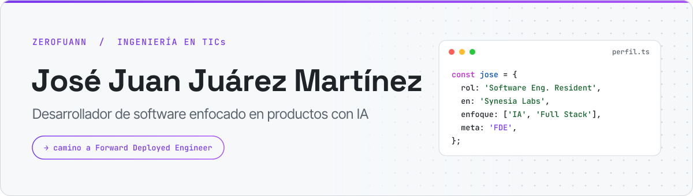
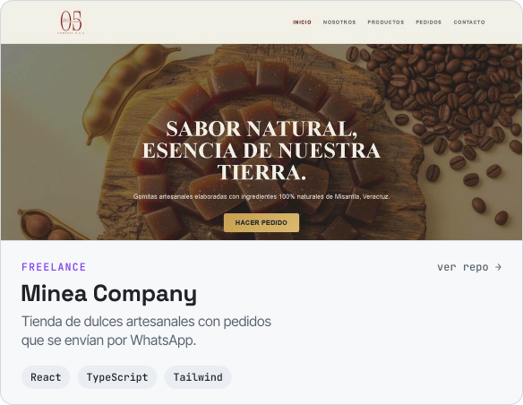
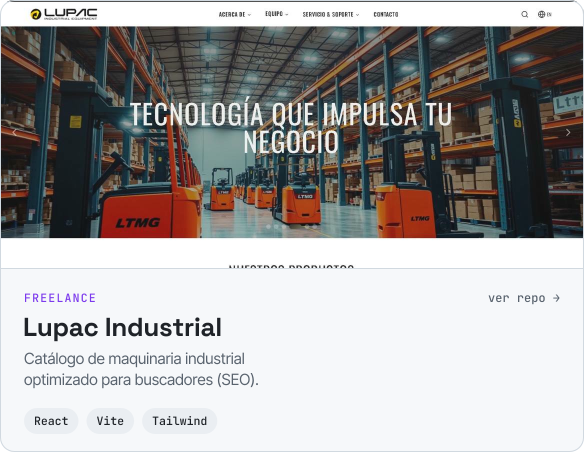
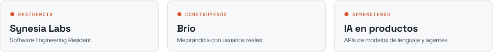
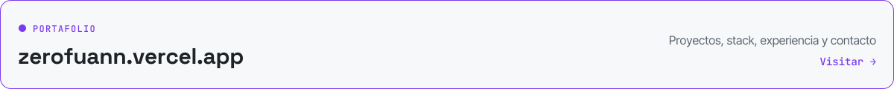
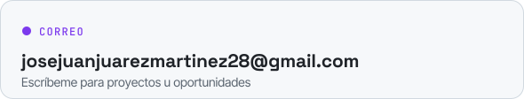

<picture><source media="(prefers-color-scheme: dark)" srcset="assets/encabezado-dark.svg"></picture>

<picture><source media="(prefers-color-scheme: dark)" srcset="assets/titulo-sobre-mi-dark.svg"></picture>

Me gusta tomar un problema real, entenderlo con quien lo vive y convertirlo en software que se usa todos los días: desde la idea y el diseño hasta la base de datos, el despliegue y los usuarios.

- **Formación.** Ingeniería en Tecnologías de la Información y Comunicaciones (2022 a la fecha).
- **Experiencia.** Software Engineering Resident en **Synesia Labs**, como parte de mi residencia profesional.
- **De punta a punta.** Frontend, backend, base de datos, despliegue y mantenimiento; mi ejemplo más completo es [Brío](https://github.com/ZeroFuann-FS/brio).
- **Trato con clientes.** Sitios freelance para empresas reales desde 2024 (mi primer cliente, Grupo MANBAL, me buscó ese año y entregué su sitio en 2025): escuchar el problema y entregar algo que funcione.
- **Visión de negocio.** Certificado como **Pega Business Architect**: entiendo el software desde el negocio, no solo desde el código.

<picture><source media="(prefers-color-scheme: dark)" srcset="assets/titulo-proyectos-dark.svg"></picture>

<a href="https://github.com/ZeroFuann-FS/brio"><picture><source media="(prefers-color-scheme: dark)" srcset="assets/proyecto-brio-dark.svg?v=2"></picture></a>
<a href="https://github.com/ZeroFuann-FS/nexus-tic"><picture><source media="(prefers-color-scheme: dark)" srcset="assets/proyecto-nexus-dark.svg?v=2"></picture></a>

<a href="https://github.com/ZeroFuann-FS/portafolio"><picture><source media="(prefers-color-scheme: dark)" srcset="assets/proyecto-portafolio-dark.svg?v=2"></picture></a>

<a href="https://github.com/ZeroFuann-FS/minea-company"><picture><source media="(prefers-color-scheme: dark)" srcset="assets/proyecto-minea-dark.svg"></picture></a>
<a href="https://github.com/ZeroFuann-FS/lupac-industrial"><picture><source media="(prefers-color-scheme: dark)" srcset="assets/proyecto-lupac-dark.svg"></picture></a>

<a href="https://github.com/ZeroFuann-FS/fana"><picture><source media="(prefers-color-scheme: dark)" srcset="assets/proyecto-fana-dark.svg?v=2"></picture></a>
<a href="https://github.com/ZeroFuann-FS/manbal"><picture><source media="(prefers-color-scheme: dark)" srcset="assets/proyecto-manbal-dark.svg?v=2"></picture></a>

Minea Company, FANA y Grupo MANBAL ya cerraron como negocios; sus sitios siguen en línea como muestra de mi trabajo.

<picture><source media="(prefers-color-scheme: dark)" srcset="assets/titulo-ia-dark.svg"></picture>

Uso **Claude** y **Claude Code** como herramientas diarias de desarrollo. Yo defino el problema, la arquitectura y las decisiones; la IA me ayuda a construir más rápido, y reviso todo lo que se sube.

<picture><source media="(prefers-color-scheme: dark)" srcset="assets/titulo-stack-dark.svg"></picture>

**IA:** Claude · Claude Code &nbsp;·&nbsp; **Negocio:** Pega (Business Architect)

<picture><source media="(prefers-color-scheme: dark)" srcset="assets/titulo-ahora-dark.svg"></picture>

<picture><source media="(prefers-color-scheme: dark)" srcset="assets/ahora-dark.svg"></picture>

<picture><source media="(prefers-color-scheme: dark)" srcset="assets/titulo-contacto-dark.svg"></picture>

<a href="https://zerofuann.vercel.app"><picture><source media="(prefers-color-scheme: dark)" srcset="assets/contacto-portafolio-dark.svg"></picture></a>

<a href="mailto:josejuanjuarezmartinez28@gmail.com"><picture><source media="(prefers-color-scheme: dark)" srcset="assets/contacto-correo-dark.svg"></picture></a>
<a href="https://www.linkedin.com/in/josejuanjuarezmartinez"><picture><source media="(prefers-color-scheme: dark)" srcset="assets/contacto-linkedin-dark.svg"></picture></a>

Fuera del código: gym y finanzas personales.
